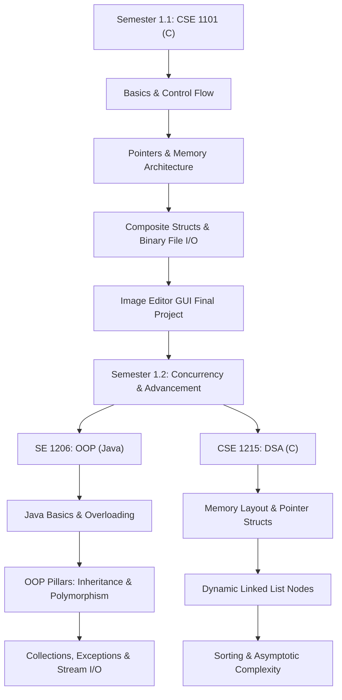

# Academic Knowledge Base — First-Year Engineering Vault

Welcome to the central portal of the academic knowledge base. This Obsidian vault documents coursework, algorithm implementations, system software, and programming paradigms across the first two semesters of undergraduate computer science and software engineering.

---

## 📚 Course Directories

| Course Hub | Title | Focus & Core Stack |
| :--- | :--- | :--- |
| [[CSE 1101 - Index]] | **CSE 1101: Structured Programming Language** | C language fundamentals, pointers, memory allocation, binary I/O, BMP image editor, IUP GUI. |
| [[OOP - Index]] | **SE 1206: Object-Oriented Programming** | Java fundamentals, classes, inheritance, polymorphism, encapsulation, collections, file I/O. |
| [[DSA - Index]] | **CSE 1215: Data Structures & Algorithms** | Memory addresses, struct arrays, linked list pointers, sorting algorithms (Bubble, Insertion, Selection). |

---

## 🛠️ Toolchain & Reference

- [[Setup - Build and run C]] — GCC compiler flags, VS Code task setups, multi-file project builds (`build.bat`), and bash test graders (`grader.sh`).
- [[Setup - Build and run Java]] — JDK toolchain, `javac`/`java` execution models, `src`/`bin` layouts, and `.vscode` settings.
- [[Tag Glossary]] — Controlled taxonomy covering Course, Language, Type, Difficulty Level, and all 51 Topic tags with embedded dynamic query blocks.

---

## 🗺️ Suggested Reading Order



1. **Foundations (Semester 1.1)**: Start with [[CSE 1101 - Index]] to master procedural control flow, pointer manipulation, and memory management in C.
2. **Object-Oriented Transition (Semester 1.2)**: Proceed to [[OOP - Index]] and [[OOP BRO - Index]]. Understand how C structs and function pointers evolve into Java classes, encapsulated fields, inheritance hierarchies, and dynamic polymorphism.
3. **Data Structures (Semester 1.2)**: Study [[DSA - Index]] and [[DSA LAB - Index]]. Trace pointer linking, dynamic node chains, and sorting complexity from first principles.

---

## 📝 Needs Review

The following live query dynamically gathers all notes across the vault that are currently marked as `status: draft`:

```query
[status:draft]
```

---

## Related
- [[CSE 1101 - Index]]
- [[OOP - Index]]
- [[DSA - Index]]
- [[Tag Glossary]]
