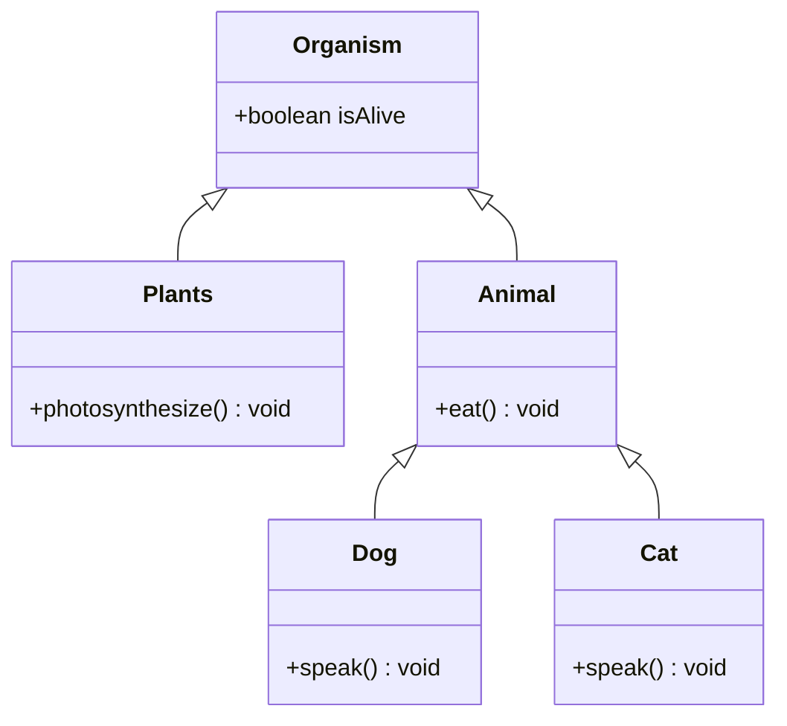

# OOP BRO 06 - inheritance

> [!abstract] Summary
> Establishes hierarchical class relationships using the `extends` keyword. Explores multi-level inheritance (`Organism` $\to$ `Animal` $\to$ `Dog`/`Cat`) and sibling derivation (`Plants`), demonstrating attribute and method reuse without code duplication.

**Source:** `1206_OOP/05_PRACTICE/01_BRO_CODE/02_OOP/06_inheritance`

| File | Primary Focus | Key Highlights |
| :--- | :--- | :--- |
| `Organism.java` | Grandparent Superclass | Top-level base class declaring `isAlive = true`. |
| `Plants.java` | Subclass of Organism | Adds `photosynthesize()` method. |
| `Animal.java` | Mid-Level Superclass | Inherits `isAlive`, adds `eat()` method. |
| `Dog.java` | Leaf Subclass | Inherits `Animal` and `Organism`, adds `speak()` (bark). |
| `Cat.java` | Leaf Subclass | Inherits `Animal` and `Organism`, adds `speak()` (meow). |
| `Main.java` | Hierarchy Execution | Instantiates `Dog`, `Cat`, `Plants`, accessing inherited and specialized methods. |

---

## The concept in plain words
**Inheritance** is the mechanism where a new class (subclass or child) inherits fields and methods from an existing class (superclass or parent). It models an **"is-a"** relationship (e.g., a Dog *is an* Animal).

---

## Class diagram


---

## Code
### `Organism.java`
```java

public class Organism {
    boolean isAlive = true; 
}
```

### `Animal.java`
```java

public class Animal extends Organism {
    void eat(){
        System.out.println("this animal is eating");
    }
}
```

### `Dog.java`
```java

public class Dog extends Animal {
    int lives = 1; 
    void sound(){
        System.out.println("the dog goes woof woof!");
    }
}
```

### `Cat.java`
```java

public class Cat extends Animal {
    int lives = 9;
    void sound(){
        System.out.println("the cat goes meow!");
    }
}
```

### `Plants.java`
```java

public class Plants extends Organism {
    void photosynthesis(){
        System.out.println("Plants abosorbs light ");
    }
}
```

### `Main.java`
```java

public class Main {
    public static void main(String[] args) {
        Dog dog = new Dog();
        Cat cat = new Cat();
        Plants plants = new Plants();

        plants.photosynthesis();
        dog.sound();
        cat.sound();
        dog.eat();

        System.out.println(plants.isAlive);
        System.out.println(dog.lives);
        System.out.println(cat.lives);
    }
}
```

---

## How it works
- `Dog extends Animal`: Dog inherits `eat()` from `Animal` and `isAlive` from `Organism`.
- Subclasses can add their own unique behavior (e.g. `Dog.speak()` outputs barking, while `Cat.speak()` outputs meowing).
- Java supports **single inheritance** for classes: a class can only directly extend one superclass.

---

## Sample Run
```text
The dog is barking: woof
The cat is meowing: meow
The plant is photosynthesizing
The animal is eating
```

---

## Gotchas
> [!warning] Single Inheritance Restriction
> Java classes do NOT allow multiple inheritance (`class Dog extends Animal, Canine` is illegal!). To achieve multiple inheritance of type, Java uses **Interfaces**.

---

## Key Takeaways
- Use `extends` to establish an is-a hierarchy.
- Promotes DRY (Don't Repeat Yourself) by consolidating shared logic in superclasses.
- Subclasses gain access to `public` and `protected` members of their parent classes.

---

## My notes
> [!question]- My notes

## Related
- [[OOP BRO 07 - super]] - Accessing superclass constructors and methods
- [[OOP BRO 08 - method overriding]] - Customizing inherited methods
- [[OOP BRO 10 - abstract]] - Forcing subclasses to implement blueprint methods
