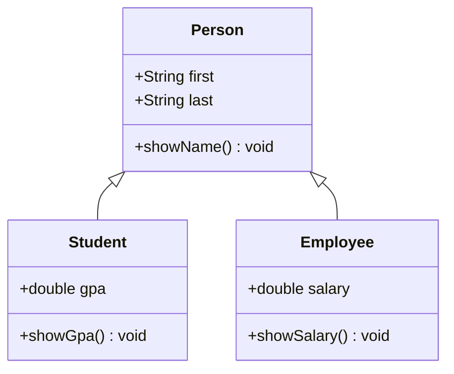

# OOP BRO 07 - super

> [!abstract] Summary
> Explains the `super` keyword in Java: invoking parent class constructors via `super(...)` to initialize inherited state, and calling superclass methods (`super.showName()`) from overridden child methods to avoid duplicating logic.

**Source:** `1206_OOP/05_PRACTICE/01_BRO_CODE/02_OOP/07_super`

| File | Primary Focus | Key Highlights |
| :--- | :--- | :--- |
| `Person.java` | Base Superclass | Holds `first`, `last`, constructor `Person(first, last)`, and `showName()` method. |
| `Student.java` | Subclass Specialization | Extends `Person`, passes names to `super(first, last)`, adds `gpa` and `showGpa()`. |
| `Employee.java` | Subclass Specialization | Extends `Person`, calls `super(first, last)`, adds `salary` and `showSalary()`. |
| `Main.java` | Driver Execution | Instantiates `Student` and `Employee`, demonstrating constructor chaining. |

---

## The concept in plain words
The `super` keyword refers directly to the immediate superclass (parent) object. It serves two primary duties:
1. `super(...)`: Calls the parent constructor to initialize inherited fields.
2. `super.method()`: Invokes parent method implementations from a child class.

---

## Class diagram


---

## Code
### `Person.java`
```java

public class Person {
    String first;
    String last;
    Person(String first, String last){
        this.first = first;
        this.last = last;
    }

    void  showName(){
        System.out.println(this.first + " " + this.last);
    }
}
```

### `Student.java`
```java

public class Student extends Person{
    double gpa;
    Student(String first, String last, double gpa){
        super(first, last);
        this.gpa = gpa;
    }

    void showGPA(){
        showName();
        System.out.println(this.first + "'s gpa is " + this.gpa);
    }
}
```

### `Employee.java`
```java

public class Employee extends Person{
    double salary;

    Employee(String first, String last , double salary){
        super(first, last);
        this.salary = salary;
    }

    void showSalary(){
        showName();
        System.out.println(this.first + "'s salary is " + this.salary);

    }
}
```

### `Main.java`
```java
public class Main {
    public static void main(String[] args) {
        Student student = new Student("Kazi", "Tanvir", 3.44);
        Employee employee = new Employee("Kazi", "Tanvir", 30000.00);

        student.showGPA();
        employee.showSalary();
    }
}
```

---

## How it works
- In `Student.java`, the constructor calls `super(first, last);` as its very first statement. This executes `Person`'s constructor, ensuring `first` and `last` are populated before `this.gpa = gpa;` executes.
- `Employee.java` repeats this pattern for `salary`.
- Shared logic remains centralized inside `Person`, while subclasses only manage their distinct attributes.

---

## Sample Run
```text
Harry Potter
3.5
Harry Potter
50000.0
```

---

## Gotchas
> [!warning] `super()` Must Be the First Statement
> Any call to `super(...)` inside a child constructor **must** be the very first line of code. Placing any statement before `super(...)` results in a compilation error.

---

## Key Takeaways
- `super(...)` eliminates code duplication across child constructors.
- The parent object is always constructed before child-specific initialization begins.
- Use `super.method()` to augment rather than completely replace parent behaviors.

---

## My notes
> [!question]- My notes

## Related
- [[OOP BRO 06 - inheritance]] - Inheritance hierarchy basics
- [[OOP BRO 08 - method overriding]] - Re-implementing parent methods
- [[OOP BRO 02 - constructor]] - Constructor mechanics
