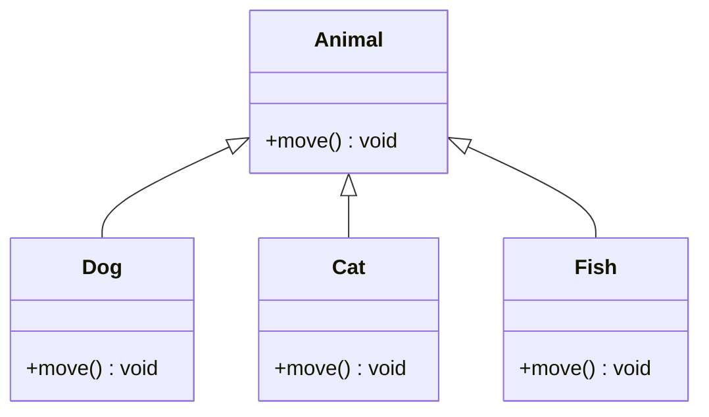

# OOP BRO 08 - method overriding

> [!abstract] Summary
> Explains method overriding in Java: when a child class provides a specialized implementation of a method already declared in its parent class, annotated with `@Override` for compile-time signature verification.

**Source:** `1206_OOP/05_PRACTICE/01_BRO_CODE/02_OOP/08_method_overriding`

| File | Primary Focus | Key Highlights |
| :--- | :--- | :--- |
| `Animal.java` | Base Superclass | Declares default generic `move()` method. |
| `Dog.java` | Overriding Subclass | Overrides `move()` to print running behavior. |
| `Cat.java` | Overriding Subclass | Overrides `move()` to print walking/prowling behavior. |
| `Fish.java` | Overriding Subclass | Overrides `move()` to print swimming behavior. |
| `Main.java` | Demonstration | Calls `move()` on different subclasses, verifying individual outputs. |

---

## The concept in plain words
**Method Overriding** occurs when a subclass defines a method that has the exact same name, return type, and parameter list as a method in its superclass. This allows child classes to adapt inherited behavior to their specific nature.

---

## Class diagram


---

## Code
### `Animal.java`
```java

public class Animal {
    void move(){
        System.out.println("this animal is running");
    }
}
```

### `Dog.java`
```java

public class Dog extends Animal{
    
}
```

### `Cat.java`
```java

public class Cat extends Animal{
    
}
```

### `Fish.java`
```java

public class Fish extends Animal {
    @Override 
    void move(){
        System.out.println("this animal is swimming");
    }
}
```

### `Main.java`
```java

public class Main {
    public static void main(String[] args) {
        Dog dog = new Dog();
        Cat cat = new Cat();
        Fish fish = new Fish();

        dog.move();
        cat.move();
        fish.move();
    }
}
```

---

## How it works
- In `Animal.java`, `void move()` prints `"This animal moves"`.
- In `Dog.java`, `@Override void move()` prints `"The dog runs"`.
- In `Fish.java`, `@Override void move()` prints `"The fish swims"`.
- When `dog.move()` is executed, Java's runtime dynamic dispatch selects `Dog`'s version.

---

## Sample Run
```text
The dog runs
The fish swims
The cat walks
```

---

## Gotchas
> [!warning] `@Override` Annotation Benefit
> While the `@Override` annotation is technically optional, omitting it is risky. If you accidentally misspell the method name (`mov()` instead of `move()`), the compiler will silently treat it as a new method rather than catching your bug!

---

## Key Takeaways
- Overriding changes *how* an existing method behaves in child classes.
- Signature (name and parameter types) must match the superclass method identically.
- Forms the core foundation for runtime (dynamic) polymorphism.

---

## My notes
> [!question]- My notes

## Related
- [[OOP BRO 06 - inheritance]] - Inheritance fundamentals
- [[OOP BRO 07 - super]] - Invoking original parent implementations
- [[OOP BRO 12 - polymorphism]] - Treating diverse objects uniformly
