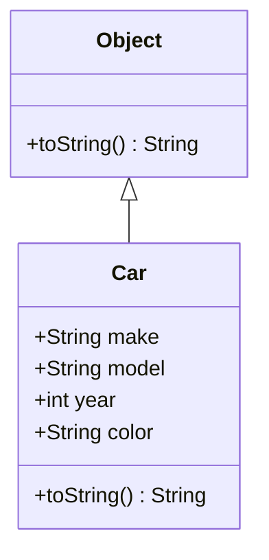

# OOP BRO 09 - toString

> [!abstract] Summary
> Explains overriding the `toString()` method inherited from `java.lang.Object`, replacing the default memory address hash representation with a clean, human-readable string summarizing the object's field values.

**Source:** `1206_OOP/05_PRACTICE/01_BRO_CODE/02_OOP/09_toString`

| File | Primary Focus | Key Highlights |
| :--- | :--- | :--- |
| `Car.java` | Custom String Representation | Overrides `toString()` to format `make`, `model`, `year`, `color` into readable text. |
| `Main.java` | Implicit toString Invocation | Printing the object reference directly with `System.out.println(car)`. |

---

## The concept in plain words
Every class in Java automatically inherits from `java.lang.Object`. By default, `Object.toString()` returns `ClassName@MemoryHashcode` (e.g. `Car@15db9742`). Overriding `toString()` gives your object an informative, human-friendly textual representation.

---

## Class diagram


---

## Code
### `Car.java`
```java

public class Car {
    String make;
    String model;
    int year;
    String color;

    Car(String make,String model,int year,String color){
        this.make = make;
        this.model = model;
        this.year = year;
        this.color = color;    
    }

    public String toString(){
        return this.make + " " + this.model + " " + this.year + " " + this.color;
    }
    
}
```

### `Main.java`
```java

public class Main {
    public static void main(String[] args) {
        Car car = new Car("Ford", "Mustang", 2006, "Red");
        System.out.println(car);
    }
}
```

---

## How it works
- In `Car.java`, `public String toString()` constructs a formatted string of the car's state.
- In `Main.java`, calling `System.out.println(car)` automatically triggers `car.toString()` behind the scenes.

---

## Sample Run
```text
Ford Mustang 2025 Red
```

---

## Gotchas
> [!warning] Forgetting `public` Modifier
> The `toString()` method in `java.lang.Object` is declared as `public`. When overriding it in your class, you cannot reduce its visibility (e.g. declaring it package-private or `protected` triggers a compile error).

---

## Key Takeaways
- Overriding `toString()` is invaluable for debugging and logging.
- `System.out.println(myObject)` automatically invokes `.toString()`.

---

## My notes
> [!question]- My notes

## Related
- [[OOP BRO 01 - class object]] - Object field structure
- [[OOP BRO 08 - method overriding]] - Overriding methods from ancestor classes
- [[OOP BRO 14 - getter n setter]] - Encapsulation and inspection
