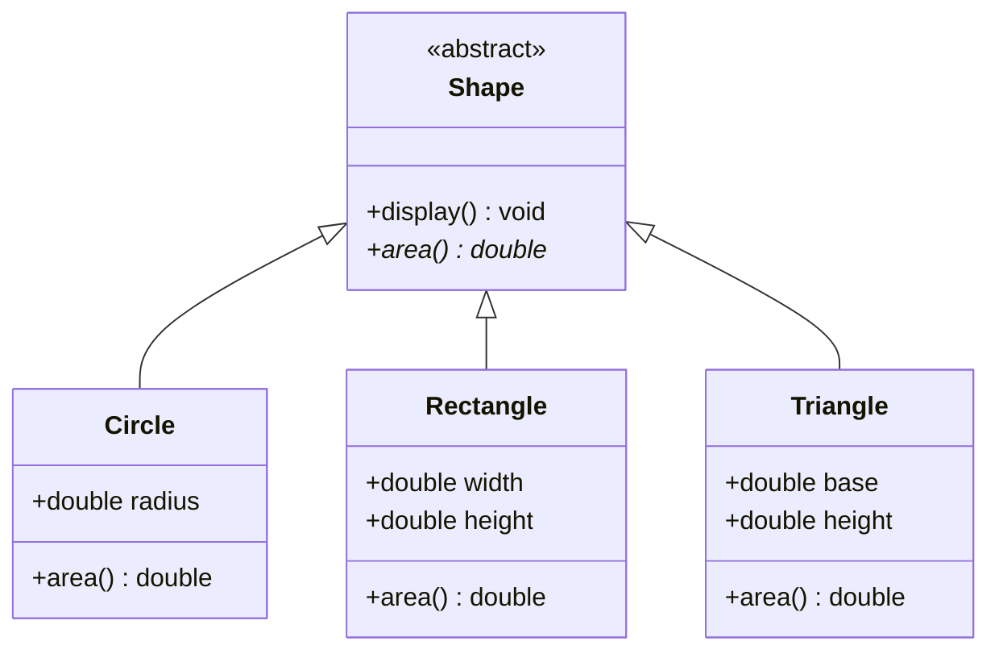

# OOP BRO 10 - abstract

> [!abstract] Summary
> Explores abstract classes and abstract methods using the `abstract` keyword. Demonstrates defining an incomplete base class (`Shape`) that cannot be instantiated directly, establishing mandatory method contracts (`area()`) that concrete subclasses must implement.

**Source:** `1206_OOP/05_PRACTICE/01_BRO_CODE/02_OOP/10_abstract`

| File | Primary Focus | Key Highlights |
| :--- | :--- | :--- |
| `Shape.java` | Abstract Base Class | Declares abstract method `abstract double area()` and concrete `display()`. |
| `Circle.java` | Concrete Subclass | Implements `area()` using $\pi r^2$. |
| `Rectangle.java` | Concrete Subclass | Implements `area()` using $w \times h$. |
| `Triangle.java` | Concrete Subclass | Implements `area()` using $0.5 \times b \times h$. |
| `Main.java` | Polymorphic Execution | Instantiates concrete subclasses and computes their areas. |

---

## The concept in plain words
An **abstract class** acts as an incomplete blueprint. It can declare **abstract methods** (methods with signatures but no body `{}`), forcing every non-abstract subclass to provide concrete implementations. Abstract classes prevent instantiation of generic concepts that make no sense on their own (like creating a bare "Shape").

---

## Class diagram


---

## Code
### `Shape.java`
```java

public abstract class Shape {
    abstract double area();

    void display(){
        System.out.println("this is a shape");
    }
}
```

### `Circle.java`
```java

public class Circle extends Shape{
    int radius;
    Circle(int radius){
        this.radius = radius;
    }

    @Override 
    double area(){
        return Math.PI*this.radius*this.radius;
    }
}
```

### `Rectangle.java`
```java


public class Rectangle extends Shape{
    int height;
    int width;
    Rectangle(int height, int width){
        this.height = height;
        this.width = width;
    }

    @Override 
    double area(){
        return this.height*this.width;
    }
}
```

### `Triangle.java`
```java

public class Triangle extends  Shape{
    int base;
    int height;
    Triangle(int base, int height){
        this.base = base;
        this.height = height;
    }

    @Override 
    double area(){
        return .5*this.base*this.height;
    } 
}
```

### `Main.java`
```java

public class Main {
    public static void main(String[] args) {
        
        Circle circle = new Circle(5);
        Rectangle rectangle = new Rectangle(4,3);
        Triangle tirangle = new Triangle(4,3);

        System.out.println(circle.area());
        System.out.println(rectangle.area());
        System.out.println(tirangle.area());

        circle.display();
        rectangle.display();
        tirangle.display();
    }   
}
```

---

## How it works
- `abstract class Shape`: Cannot be instantiated with `new Shape()`.
- `abstract double area();`: Defines the method contract ending with a semicolon.
- `Circle`, `Rectangle`, and `Triangle` provide formulas tailored to their geometry.
- `display()` in `Shape` is a concrete method inherited as-is by all subclasses.

---

## Sample Run
```text
This is a shape
28.274333882308138
This is a shape
20.0
This is a shape
12.0
```

---

## Gotchas
> [!warning] Mandatory Implementation Rule
> If a child class fails to implement *all* abstract methods inherited from its parent, the child class itself must be declared `abstract`, preventing instantiation.

---

## Key Takeaways
- Abstract classes provide both shared concrete code and mandatory abstract contracts.
- You cannot create objects directly from an abstract class (`new Shape()` is invalid).
- Serves as a stepping stone between inheritance and 100% abstract Interfaces.

---

## My notes
> [!question]- My notes

## Related
- [[OOP BRO 11 - interfaces]] - Fully abstract behavioral contracts
- [[OOP BRO 06 - inheritance]] - Standard class inheritance
- [[OOP BRO 08 - method overriding]] - Implementing inherited methods
