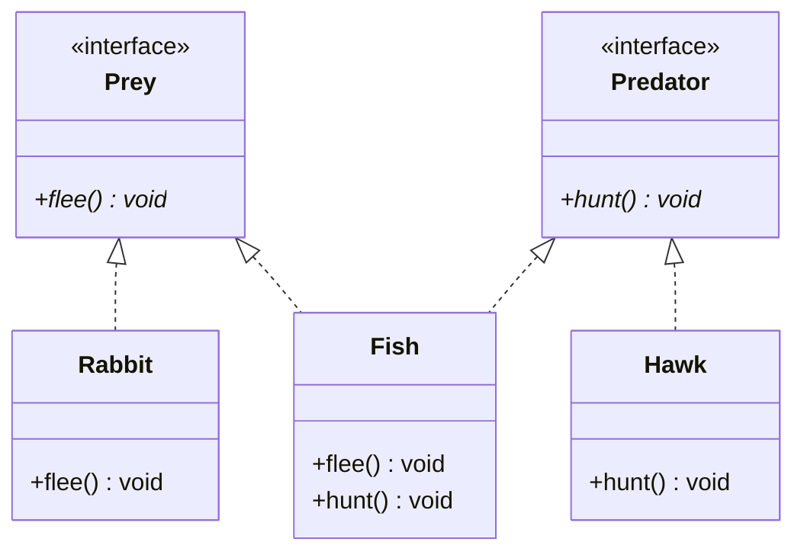

# OOP BRO 11 - interfaces

> [!abstract] Summary
> Explores Java `interface` types: pure behavioral contracts implemented using the `implements` keyword. Demonstrates achieving multiple inheritance of behavior through a class (`Fish`) implementing multiple interfaces (`Prey`, `Predator`).

**Source:** `1206_OOP/05_PRACTICE/01_BRO_CODE/02_OOP/11_Interfaces`

| File | Primary Focus | Key Highlights |
| :--- | :--- | :--- |
| `Prey.java` | Interface Contract | Declares `flee()` method. |
| `Predator.java` | Interface Contract | Declares `hunt()` method. |
| `Rabbit.java` | Single Implementation | Implements `Prey` (`flee()`). |
| `Hawk.java` | Single Implementation | Implements `Predator` (`hunt()`). |
| `Fish.java` | Multiple Implementation | Implements **both** `Prey` and `Predator` (`flee()` and `hunt()`). |
| `Main.java` | Driver Execution | Calls behavioral methods across diverse creature types. |

---

## The concept in plain words
An **interface** is a formal contract specifying *what* a class must do, but not *how* it does it. While a class can only extend one parent class, it can implement **any number of interfaces**, solving the multiple inheritance problem cleanly.

---

## Class diagram


---

## Code
### `Prey.java`
```java

public interface Prey {
    void flee();   
}
```

### `Predator.java`
```java

public interface Predator {
    void hunt();
}
```

### `Rabbit.java`
```java

public class Rabbit implements Prey{
    @Override 
    public void flee(){
        System.out.println("the rabbit is running");
    }
    
}
```

### `Hawk.java`
```java

public class Hawk implements Predator{
    @Override 
    public void hunt(){
        System.out.println("the hawk is hunting");
    }
}
```

### `Fish.java`
```java

public class Fish implements Prey, Predator{
    @Override 
    public void flee(){
        System.out.println("the rabbit is running");
    }
    @Override 
    public void hunt(){
        System.out.println("the fish is hunting");
    }
}
```

### `Main.java`
```java

public class Main {
    public static void main(String[] args) {
        Rabbit rabbit = new Rabbit();
        Hawk hawk = new Hawk();
        Fish fish = new Fish();

        rabbit.flee();
        hawk.hunt();
        fish.flee();
        fish.hunt();
    }
}
```

---

## How it works
- In `Rabbit.java`: `public class Rabbit implements Prey` provides concrete `flee()` implementation.
- In `Fish.java`: `public class Fish implements Prey, Predator` implements both `flee()` and `hunt()`.
- Interfaces describe capabilities (e.g. "can flee", "can hunt") that can be shared across completely unrelated class trees.

---

## Sample Run
```text
The rabbit is fleeing
The hawk is hunting
The fish is fleeing
The fish is hunting
```

---

## Gotchas
> [!warning] All Interface Methods are Implicitly Public
> Methods in an interface are automatically `public abstract`. When implementing them in your class, you must explicitly declare them with the `public` modifier.

---

## Key Takeaways
- Interfaces provide behavioral contracts without dictating class hierarchy.
- A class can implement multiple interfaces (`implements A, B, C`).
- Facilitates loose coupling and polymorphic design.

---

## My notes
> [!question]- My notes

## Related
- [[OOP BRO 10 - abstract]] - Abstract classes vs interfaces
- [[OOP BRO 12 - polymorphism]] - Polymorphism via interface types
- [[OOP BRO 06 - inheritance]] - Single class inheritance
