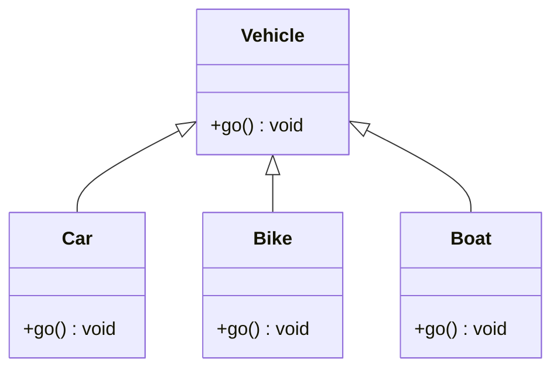

# OOP BRO 12 - polymorphism

> [!abstract] Summary
> Explores subtype polymorphism in Java: treating objects of diverse derived types (`Car`, `Bike`, `Boat`) uniformly through their common superclass reference type (`Vehicle[]`), invoking overridden methods dynamically in an iteration loop.

**Source:** `1206_OOP/05_PRACTICE/01_BRO_CODE/02_OOP/12_Polymorphism`

| File | Primary Focus | Key Highlights |
| :--- | :--- | :--- |
| `Vehicle.java` | Base Superclass | Declares base `go()` method. |
| `Car.java` | Derived Class | Overrides `go()` to output driving. |
| `Bike.java` | Derived Class | Overrides `go()` to output pedaling. |
| `Boat.java` | Derived Class | Overrides `go()` to output sailing. |
| `Main.java` | Polymorphic Array | Groups `Car`, `Bike`, and `Boat` into a single `Vehicle[]` array and iterates. |

---

## The concept in plain words
**Polymorphism** (Greek for "many forms") is the ability of an object to take on many forms. A reference variable of a parent class type can point to an instance of any of its child classes.

---

## Class diagram


---

## Code
### `Vehicle.java`
```java

public interface Vehicle {
    abstract void go();
    
}
```

### `Car.java`
```java

public class Car implements Vehicle{
    @Override 
    public void go(){
        System.out.println("the vehicle is goiing");
    }
}
```

### `Bike.java`
```java

public class Bike implements Vehicle {
    @Override 
    public void go(){
        System.out.println("the vehicle is goiing");
    }
}
```

### `Boat.java`
```java

public class Boat implements Vehicle {
    @Override 
    public void go(){
        System.out.println("the vehicle is goiing");
    }
}
```

### `Main.java`
```java

public class Main {
    public static void main(String[] args) {
        Car car = new Car();
        Boat boat = new Boat();
        Bike bike = new Bike();

        Vehicle[] vehicles = { car, boat, bike};
        for (Vehicle vehicle : vehicles) {
            vehicle.go();
        }
    }
}
```

---

## How it works
- `Vehicle[] racers = {car, bike, boat};`: Java permits storing `Car`, `Bike`, and `Boat` in a `Vehicle[]` array because every child *is-a* `Vehicle`.
- In `for (Vehicle x : racers) { x.go(); }`, the runtime JVM identifies the concrete object type and invokes the matching child method (dynamic method dispatch).

---

## Sample Run
```text
The car begins moving
The bike begins moving
The boat begins moving
```

---

## Gotchas
> [!warning] Reference Type Determines Accessible Members
> When referring to a `Car` through a `Vehicle` variable (`Vehicle v = new Car();`), you can only invoke methods declared on `Vehicle`! If `Car` has a specialized method `drift()`, `v.drift()` will fail to compile unless downcasted.

---

## Key Takeaways
- Polymorphism enables writing flexible, extensible code that operates on general supertypes.
- New subclasses can be added without modifying existing processing loops.

---

## My notes
> [!question]- My notes

## Related
- [[OOP BRO 13 - dynamic polymorphism]] - Runtime user-decided polymorphic instantiation
- [[OOP BRO 08 - method overriding]] - Overridden methods invoked polymorphically
- [[OOP BRO 06 - inheritance]] - Inheritance hierarchy
