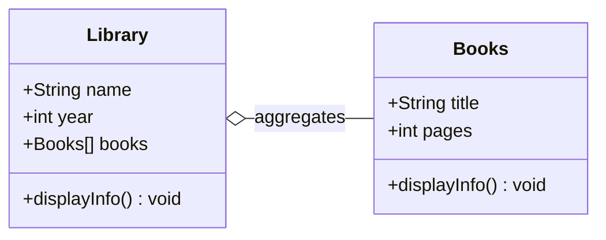

# OOP BRO 15 - aggregation

> [!abstract] Summary
> Explores Aggregation in Java: a weak "has-a" relationship where an aggregate object (`Library`) contains references to independent component objects (`Books[]`). If the library ceases to exist, the individual books continue to exist independently.

**Source:** `1206_OOP/05_PRACTICE/01_BRO_CODE/02_OOP/15_aggregation`

| File | Primary Focus | Key Highlights |
| :--- | :--- | :--- |
| `Books.java` | Independent Component | Represents a book with `title`, `pages`, and `displayInfo()`. |
| `Library.java` | Aggregate Container | Represents a library holding `name`, `year`, and an array of `Books[]`. |
| `Main.java` | Assembly & Execution | Instantiates standalone book objects, passes the array into `Library`, and prints inventory. |

---

## The concept in plain words
**Aggregation** represents a "has-a" association where both entities can exist independently. A Library *has* Books, but if the Library is demolished or closed, the Books do not vanish—they can be moved elsewhere.

---

## Class diagram


---

## Code
### `Books.java`
```java

public class Books {
    String name;
    int pages;

    Books(String name, int pages){
        this.name = name;
        this.pages = pages;
    }

    void displayInfo(){
        System.out.println(this.name + " has (" +this. pages + "pages)");
    }
}
```

### `Library.java`
```java

public class Library {
    String name;
    int year;
    Books[] books;

    Library(String name, int year, Books[] books){
        this.name = name;
        this.year = year;
        this.books = books;
    }

    void displayInfo(){
        System.out.println(this.name + "(" + this.year + ")");
        for (Books book : books) {
            System.out.println(book.name + " has (" + book.pages + "pages)");
        }
    }
}
```

### `Main.java`
```java

public class Main {
    public static void main(String[] args) {
        
        Books[] books = {
            new Books("First book", 414),
            new Books("Second book", 355),
            new Books("Third book", 514)
        } ;

        Library library = new Library("Library" , 2006 , books);

        library.displayInfo();
    }
}
```

---

## How it works
- In `Main.java`, `Books book1 = new Books("Harry Potter", 500);` is created outside `Library`.
- An array `Books[] books = {book1, book2, book3};` is passed into `new Library("City Library", 1995, books)`.
- `Library.displayInfo()` iterates over the contained books and delegates display logic to `book.displayInfo()`.

---

## Sample Run
```text
The 1995 City Library
The Harry Potter (500 pages)
The Lord of the Rings (800 pages)
The Hobbit (350 pages)
```

---

## Gotchas
> [!warning] Shallow Copy & Shared References
> Because `Library` stores references to the existing `Books` objects, modifying a book externally (`book1.pages = 600`) will immediately reflect inside the library's inventory.

---

## Key Takeaways
- Aggregation models whole-part relationships with weak ownership (unbound lifecycles).
- Denoted in UML diagrams with an open/unfilled diamond (`o--`).

---

## My notes
> [!question]- My notes

## Related
- [[OOP BRO 16 - composition]] - Strong ownership composition
- [[OOP BRO 04 - array of objects]] - Arrays of references
- [[OOP BRO 01 - class object]] - Object design
