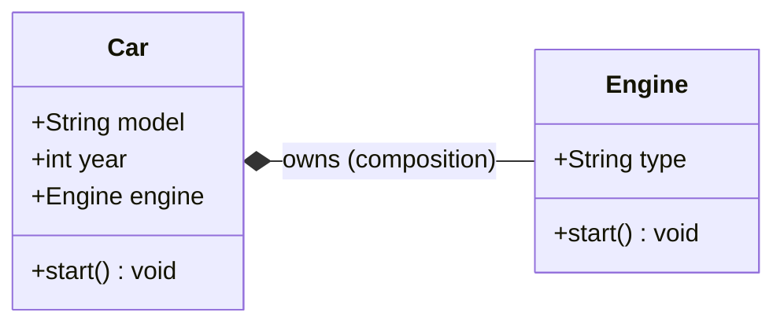

# OOP BRO 16 - composition

> [!abstract] Summary
> Explores Composition in Java: a strong "part-of" relationship where a composite object (`Car`) owns and instantiates its component object (`Engine`) directly inside its constructor. The component's lifecycle is strictly tied to the composite owner.

**Source:** `1206_OOP/05_PRACTICE/01_BRO_CODE/02_OOP/16_composition`

| File | Primary Focus | Key Highlights |
| :--- | :--- | :--- |
| `Engine.java` | Component Part | Represents an engine with `type` and `start()` method. |
| `Car.java` | Composite Owner | Instantiates `this.engine = new Engine(engineType)` inside its own constructor; provides delegated `start()` method. |
| `Main.java` | Driver Testing | Creates `Car` instances and invokes `start()`, triggering the owned engine. |

---

## The concept in plain words
**Composition** is a strict form of association where the part cannot exist independently of the whole. A `Car` *owns* its `Engine`. The `Engine` is created when the `Car` is created, and if the `Car` is garbage collected, the `Engine` is destroyed along with it.

---

## Class diagram


---

## Memory picture
```text
STACK                       HEAP
+-------------------+       +---------------------------+
| car (ref: 0x600)  | ----> | Car Object (at 0x600)     |
+-------------------+       | - model: "Corvette"       |
                            | - year: 2025              |
                            | - engine: ref 0x700 ------|---> Engine Object (at 0x700)
                            +---------------------------+     | - type: "V8"
                                                              +-----------------------+
```

---

## Code
### `Engine.java`
```java

public class Engine {
    String type;
    Engine(String type){
        this.type = type;
    }

    void start(){
        System.out.println("You start the " + this.type + " engine");
    }
}
```

### `Car.java`
```java

public class Car {
    String model;
    int year;
    Engine engine;

    Car(String model, int year, String engineType){
        this.model = model;
        this.year = year;
        this.engine = new Engine(engineType) ;
    }

    void start(){
        this.engine.start();
        System.out.println("This " + this.model + " running");
        
    }
}
```

### `Main.java`
```java

public class Main {
    public static void main(String[] args) {
        Car car = new Car("ford" , 2005 , "V8");
        System.out.println(car.model);
        System.out.println(car.year);
        System.out.println(car.engine.type);

        car.start();
    }
    
}
```

---

## How it works
- In `Car.java`: `this.engine = new Engine(engineType);` instantiates the engine directly during car construction.
- `Car.start()` calls `engine.start()`, demonstrating method delegation.
- Denoted in UML with a filled black diamond (`*--`).

---

## Sample Run
```text
You start the V8 engine
You drive the 2025 Corvette
```

---

## Gotchas
> [!warning] Favor Composition Over Inheritance
> A classic OOP design maxim states: *"Favor object composition over class inheritance"*. Composition provides greater flexibility, avoids deep rigid inheritance trees, and prevents fragile superclass side-effects.

---

## Key Takeaways
- Composition enforces strong lifecycle binding between container and component.
- The component is not exposed directly; the container delegates calls to it.

---

## My notes
> [!question]- My notes

## Related
- [[OOP BRO 15 - aggregation]] - Weak ownership vs strong composition
- [[OOP BRO 01 - class object]] - Encapsulating state
- [[OOP BRO 02 - constructor]] - Automatic internal initialization
