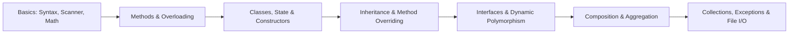

# SE 1206: Object-Oriented Programming (Java) — Knowledge Base

Welcome to the knowledge base for **SE 1206: Object-Oriented Programming (Java)**. This course builds directly upon first-principles procedural programming in C, transitioning into modern class-based software architecture, strong type systems, object lifecycles on the managed heap, inheritance hierarchies, polymorphic dispatch, and robust error management.

---

## 📂 Practice Sequences

| # | Note | What it teaches | Core tags |
| :-: | :--- | :--- | :--- |
| 1 | [[OOP BRO - Index]] | Comprehensive Bro Code Java curriculum: 13 syntax/algorithm basics drills and 24 deep object-oriented architectural topics. | `course/1206-se`, `lang/java`, `type/index` |

---

## 🎯 Conceptual Progression

The course progression moves deliberately through six evolutionary milestones:
1. **Procedural to Class Transformation**: Primitive data types, expressions, Scanner user input, and formatted printing transition from C-style idioms to Java virtual machine execution.
2. **Encapsulation & Instantiation**: Grouping variables and subroutines into classes, allocating objects on the heap with constructors, and protecting state with private modifiers and accessors.
3. **Class Hierarchies**: Reusing and specializing behaviors using `extends`, calling parent initializers via `super()`, and substituting subclasses via polymorphic dispatch.
4. **Contractual Abstraction**: Decoupling implementation details from interfaces using `abstract` classes and multiple interface inheritance (`implements`).
5. **Object Relationships**: Modeling real-world systems via composition (tight ownership) and aggregation (loose association).
6. **Enterprise Resilience**: Safe file stream handling with `try-with-resources`, type-safe collections (`ArrayList`), and defensive exception hierarchies.

---

## 📌 Planned Folders

The following course subdirectories are currently empty placeholders in the repository and will be populated as formal coursework proceeds:
- `1206_OOP/01_CLASS` — Lecture notes and live classroom coding demonstrations.
- `1206_OOP/02_LAB` — Structured lab sessions and graded coding experiments.
- `1206_OOP/03_ASSIGNMENT` — Homework problem sets and programming assignments.
- `1206_OOP/04_LAB_PROJECT` — Term projects, multi-tier applications, and exam archives.
- `1206_OOP/05_PRACTICE/BOOK` — Exercises and code implementations from textbook chapters.
- `1206_OOP/99_ARCHIVE` — Post-mortems, bug logs, and experimental prototypes.

---

## Related
- [[00 - Home]] — Main Knowledge Base Portal
- [[OOP BRO - Index]] — Bro Code Practice Sequence Index
- [[Setup - Build and run Java]] — JDK Toolchain and Compiler Setup
- [[CSE 1101 - Index]] — Prerequisite C Programming Knowledge Base
- [[DSA - Index]] — Concurrent Data Structures & Algorithms Course
