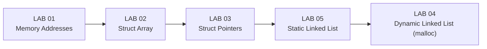

# DSA LAB - Index

> [!abstract] Summary
> Index of laboratory experiments covering memory address layout, struct record processing, pointer arithmetic on custom structures, dynamic memory allocation, and linked list construction in C.

---

## Laboratory Experiments

| Note | Source File | Topics | Description |
| :--- | :--- | :--- | :--- |
| [[DSA LAB 01 - find add]] | `01_lab_find_add.c` | Addresses, Pointers, Arrays | Printing stack addresses of scalar variables vs contiguous array memory blocks. |
| [[DSA LAB 02 - student struct]] | `02_student_struct.c` | Structs, Arrays, File-IO | Reading student records from `input.txt` into a global struct array. |
| [[DSA LAB 03 - student struct ptr]] | `03_student_struct_ptr.c` | Pointers, Structs, File-IO | Passing pointers to struct arrays and navigating fields via `ptr->field`. |
| [[DSA LAB 04 - link list student]] | `04_link_list_student.c` | Dynamic Memory, Linked Lists | Building a singly linked list of student records using `malloc()` and pointer chaining. |
| [[DSA LAB 05 - link list basic]] | `05_link_list_basic.c` | Linked Lists, Structs | Statically linking stack-allocated struct nodes via `.next` pointers. |

---

## Progression Flow

---

## Related Notes
- [[DSA - Index]] - Course Overview
- [[DSA PROJ 01 - student]] - Comprehensive Student Database Project
- [[ASG 10 - self ref struct]] - Self-referential structures in C
