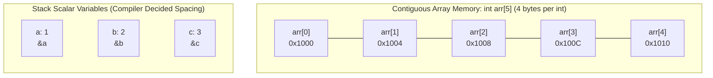

# DSA LAB 01 - find add

> [!abstract] Summary
> Investigates physical memory layout in C: using the address-of operator `&` and formatted printf specifier `%p` to observe stack address allocation for individual scalar variables versus contiguous allocation for array elements.

**Source:** `1215_DSA/02_LAB/01_lab_find_add.c`

---

## The concept in plain words
Every variable allocated by a C program resides at a specific physical memory address in RAM.
- **Scalar variables**: Declared independently; their relative placement on the call stack depends on compiler optimization, alignment, and stack growth direction.
- **Array elements**: Guaranteed by the C language standard to occupy strictly **contiguous** memory bytes, spaced exactly `sizeof(type)` bytes apart.

---

## Data structure diagram


---

## Code
```c
#include<stdio.h>

// find address of var and arr


int main(){
    int a, b, c, d, e;
    a = 1;
    b = 2;
    c = 3;
    d = 4;
    e = 5;    printf(" %p %p %p %p %p\n", &a, &b, &c, &d, &e);
    int arr[] = {1, 2, 3, 4, 5};

    printf(" %p %p %p %p %p\n", &a, &b, &c, &d, &e);
    printf(" %p %p %p %p %p\n", &arr[0], &arr[1], &arr[2], &d, &e);


}
```

---

## How it works
- `&a`, `&b`, `&c`, `&d`, `&e`: Obtains the memory address of each integer on the stack frame.
- `%p`: The standard C format specifier for printing pointer addresses (usually in hexadecimal).
- `&arr[0]`, `&arr[1]`, etc.: Reveals that each successive array element's address increases by exactly `4` bytes (the size of a 32-bit `int` on x86/x64 systems).

---

## Sample Run
```text
 0061FF1C 0061FF18 0061FF14 0061FF10 0061FF0C
 0061FF1C 0061FF18 0061FF14 0061FF10 0061FF0C
 0061FEF4 0061FEF8 0061FEFC 0061FF00 0061FF04
```

---

## Dry run
| Variable / Element | Value | Address (Hex) | Distance from Prior |
| :--- | :--- | :--- | :--- |
| `arr[0]` | 1 | `0x...EF4` | Base |
| `arr[1]` | 2 | `0x...EF8` | +4 bytes |
| `arr[2]` | 3 | `0x...EFC` | +4 bytes |
| `arr[3]` | 4 | `0x...F00` | +4 bytes |
| `arr[4]` | 5 | `0x...F04` | +4 bytes |

---

## Complexity
- **Time Complexity**: $O(1)$ constant time operations.
- **Space Complexity**: $O(1)$ auxiliary stack space.

---

## Gotchas
> [!warning] Pointer Formatting Specifier
> Always use `%p` (not `%d` or `%x`) to print pointers. On 64-bit platforms, pointers are 8 bytes long; using `%d` truncates the address to 4 bytes and triggers compiler warnings.

---

## Key Takeaways
- The `&` operator extracts memory addresses.
- Array indices map directly to base address offsets: `&arr[i] == arr + i`.

---

## My notes
> [!question]- My notes

## Related
- [[DSA LAB 02 - student struct]] - Organizing memory into composite structs
- [[CLASS 12 - pointer strlen]] - Pointer dereferencing and arithmetic
- [[Setup - Build and run C]] - Compiling C programs with GCC
