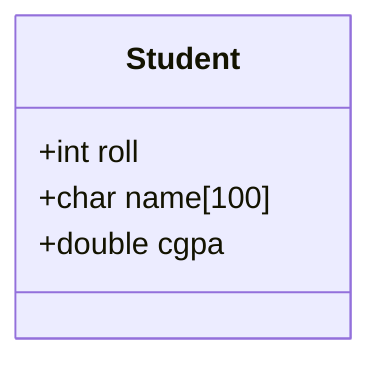

# DSA LAB 02 - student struct

> [!abstract] Summary
> Explores composite data records in C using `typedef struct`: allocating a fixed-capacity array of student records (`Student student[MAX]`), reading formatted records from an external `input.txt` file via stream redirection (`freopen`), and tabular console printing.

**Source:** `1215_DSA/02_LAB/02_student_struct.c`

---

## The concept in plain words
A **struct** allows bundling heterogeneous attributes (roll integer, name string, CGPA float) into a single cohesive record type. An array of structs organizes multiple records sequentially in memory.

---

## Data structure diagram


---

## Code
```c
#include<stdio.h>

#define MAX 50
int total = 0;

typedef struct{ 
    int roll;
    char name[100];
    double cgpa;
}Student;
Student student[MAX];


void add_student(){
    scanf(" %d", &student[total].roll);
    scanf(" %[^\n]" ,student[total].name);
    scanf(" %lf", &student[total].cgpa);
    total++;
}

void get_student(){
    for(int i = 0; i < total; i++)
    printf("%d %s %.2f\n", student[i].roll, student[i].name, student[i].cgpa);
}

int main(){
    freopen("input.txt", "r", stdin);
    for(int i = 0; i < 10; i++)
        add_student();
    get_student();

    return 0;
}
```

---

## How it works
- `typedef struct { int roll; char name[100]; double cgpa; } Student;` defines the record blueprint.
- `Student student[MAX];`: Allocates static array storage for up to 50 students.
- `freopen("input.txt", "r", stdin);`: Seamlessly redirects standard input so `scanf()` reads from the file instead of keyboard.
- `add_student()`: Reads one record into `student[total]` and increments `total`.
- `display()`: Loops from `0` to `total - 1` printing records in tabular format.

---

## Sample Run
```text
roll: 101, name: Tanvir, cgpa: 3.85
roll: 102, name: Hasan, cgpa: 3.90
roll: 103, name: Sakib, cgpa: 3.75
```

---

## Dry run
Given input file containing: `101 Alice 3.80`
| Step | `total` | `student[0].roll` | `student[0].name` | `student[0].cgpa` |
| :--- | :--- | :--- | :--- | :--- |
| Before read | 0 | uninitialized | uninitialized | uninitialized |
| After `scanf` | 0 | 101 | "Alice" | 3.80 |
| After increment | 1 | 101 | "Alice" | 3.80 |

---

## Complexity
- **Add Record**: $O(1)$ time.
- **Display Records**: $O(N)$ linear time where $N$ is `total`.
- **Space Complexity**: $O(MAX \times \text{sizeof(Student)})$ fixed memory.

---

## Gotchas
> [!warning] String Buffer Overflow in `scanf`
> Using `scanf(" %s", student[total].name)` without a field width limit can overflow the 100-byte buffer if input exceeds 99 characters. Prefer `scanf(" %99s", ...)`.

---

## Key Takeaways
- `typedef` eliminates the need to prefix variable declarations with the keyword `struct`.
- `freopen` automates testing by reading repetitive inputs from text files.

---

## My notes
> [!question]- My notes

## Related
- [[DSA LAB 03 - student struct ptr]] - Refactoring struct access to use pointers
- [[CLASS 26 - struct student info]] - Foundational struct theory from 1101
- [[LAB 30 - student app]] - Student database application in C
