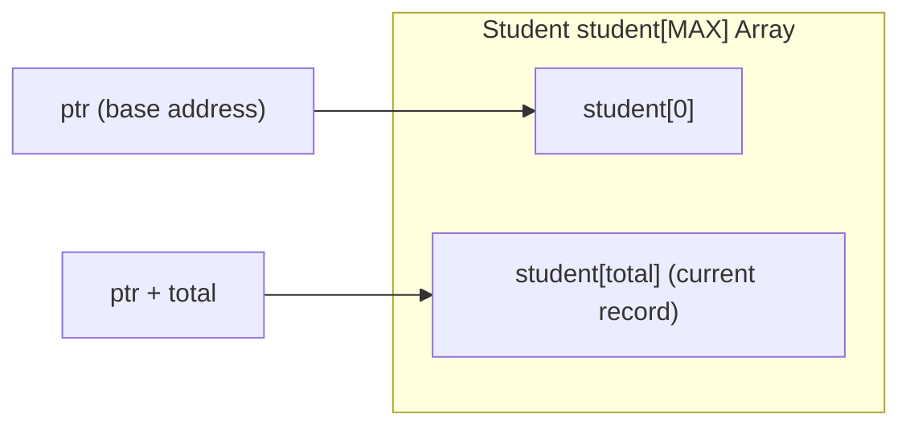

# DSA LAB 03 - student struct ptr

> [!abstract] Summary
> Extends struct processing by passing struct array pointers (`Student *ptr`) into modular helper functions, demonstrating pointer offset arithmetic `(ptr + total)` and member access via the arrow operator (`->`).

**Source:** `1215_DSA/02_LAB/03_student_struct_ptr.c`

---

## The concept in plain words
Passing large structs by value copies every single byte onto the stack, wasting time and memory. Passing a **pointer to a struct** passes only an 8-byte memory address. The arrow operator (`ptr->member`) dereferences the pointer and accesses the field in a single clean syntax.

---

## Data structure diagram


---

## Code
```c
#include <stdio.h>

#define MAX 50
int total = 0;

typedef struct
{
    int roll;
    char name[100];
    double cgpa;
} Student;

void add_student(Student *ptr)
{
    scanf(" %d", &ptr->roll);
    scanf(" %[^\n]", ptr->name);
    scanf(" %lf", &ptr->cgpa);
    total++;
}


void get_student(Student *ptr)
{
    for(int i = 0; i < 10; i++){
        printf("%d %s %.2f\n", ptr->roll, ptr->name, ptr->cgpa);
        ptr++;
    }
}

int main()
{
    Student student[MAX];
    freopen("input.txt", "r", stdin);
    for (int i = 0; i < 10; i++)
    {
        add_student(&student[i]);
    }
    get_student(student);

    return 0;
}
```

---

## How it works
- `void add_student(Student *ptr)`: Receives the base address of the struct array.
- Pointer arithmetic `(ptr + total)` calculates the exact memory location of the next open slot.
- `(ptr + total)->roll` is equivalent to `(*(ptr + total)).roll` or `ptr[total].roll`.
- `void display(Student *ptr)` iterates through elements using `(ptr + i)->field`.

---

## Sample Run
```text
roll: 201, name: Rahim, cgpa: 3.70
roll: 202, name: Karim, cgpa: 3.82
```

---

## Dry run
| Operation | Expression | Effective Address | Target Field Modified |
| :--- | :--- | :--- | :--- |
| Read Roll | `(ptr + 0)->roll` | `0x1000 + 0` | `student[0].roll` |
| Read Name | `(ptr + 0)->name` | `0x1000 + 4` | `student[0].name` |
| Next Student | `(ptr + 1)->roll` | `0x1000 + sizeof(Student)` | `student[1].roll` |

---

## Complexity
- **Time Complexity**: $O(1)$ per addition; $O(N)$ for display.
- **Space Complexity**: $O(1)$ auxiliary memory (pointer pass by reference).

---

## Gotchas
> [!warning] Arrow Operator vs Dot Operator
> - Use dot (`.`) when working with direct struct variables (`my_student.roll`).
> - Use arrow (`->`) when working with struct pointers (`student_ptr->roll`).

---

## Key Takeaways
- Struct pointers avoid expensive stack copying.
- `(ptr + i)->member` cleanly combines offset indexing with field dereferencing.

---

## My notes
> [!question]- My notes

## Related
- [[DSA LAB 02 - student struct]] - Direct struct array manipulation
- [[DSA LAB 04 - link list student]] - Moving from arrays to dynamic linked list nodes
- [[CLASS 26 - struct student info]] - Struct fundamentals in C
