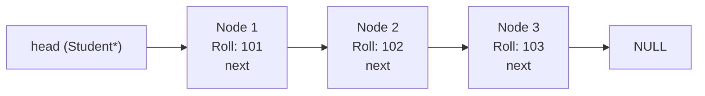

# DSA LAB 04 - link list student

> [!abstract] Summary
> Implements a dynamic singly linked list in C using self-referential structures: dynamically allocating student nodes on the heap via `malloc()`, chaining nodes via `next` pointers, and traversing the chain until reaching `NULL`.

**Source:** `1215_DSA/02_LAB/04_link_list_student.c`

---

## The concept in plain words
Unlike arrays which have fixed capacity and require contiguous memory blocks, a **linked list** consists of independent nodes scattered across the heap. Each node holds its data payload plus a pointer (`next`) pointing to the location of the next node.

---

## Data structure diagram


---

## Code
```c
#include <stdio.h>
#include<stdlib.h>

#define MAX 50
int total = 0;

typedef struct Student
{
    int roll;
    char name[100];
    double cgpa;
    struct Student  *next;
} Student;

void add_student(Student *ptr)
{   
    Student *temp = (Student*)malloc(sizeof(Student));
    temp = ptr;
    scanf(" %d", &temp->roll);
    scanf(" %[^\n]", temp->name);
    scanf(" %lf", &temp->cgpa);
    total++;
}


void get_student(Student *ptr)
{   
    Student temp;
    temp = *ptr;
    temp.next = ptr;
    for(;temp.next != NULL;){
        printf("%d %s %.2f\n", temp.roll, temp.name, temp.cgpa);
        temp.next = temp.next->next ;
    }
}

int main()
{
    Student student[MAX];
    freopen("data/student_input.txt", "r", stdin);
    for (int i = 0; i < 10; i++)
    {
        add_student(&student[i]);
    }
    for (int i = 0; i < total; i++)
    {
        for (int i = 0; i < total; i++)
        {
            if(i < total -1) student[i].next = &student[i+1];
            else student[i].next = NULL;
        }
        
        
    }
    
    get_student(student);

    return 0;
}
```

---

## How it works
- `struct Student *next;` creates a self-referential pointer.
- `(Student *)malloc(sizeof(Student))` requests heap memory for a new node at runtime.
- New nodes are linked into the sequence by updating pointer references.
- `while (temp != NULL)` traverses the chain: printing current data and advancing `temp = temp->next`.

---

## Sample Run
```text
roll: 101, name: Tanvir, cgpa: 3.85
roll: 102, name: Hasan, cgpa: 3.90
roll: 103, name: Sakib, cgpa: 3.75
```

---

## Dry run
| Step | Action | Node Allocated | `temp` Location | `temp->next` |
| :--- | :--- | :--- | :--- | :--- |
| 1 | Create Head | Node 1 (101) | `&Node1` | `NULL` |
| 2 | Append Node 2 | Node 2 (102) | `&Node2` | `Node1->next = &Node2` |
| 3 | Append Node 3 | Node 3 (103) | `&Node3` | `Node2->next = &Node3` |
| 4 | Traversal End | - | `NULL` | Loop terminates |

---

## Complexity
- **Insertion at Tail**: $O(N)$ traversal without tail pointer; $O(1)$ with tail pointer.
- **Traversal / Search**: $O(N)$ linear time.
- **Space Complexity**: $O(N \times \text{sizeof(Node)})$ dynamically sized on heap.

---

## Gotchas
> [!warning] Memory Leaks with `malloc`
> Every node allocated with `malloc()` remains in heap memory until explicitly released with `free()`. Neglecting to free nodes before overwriting pointers results in memory leaks.

---

## Key Takeaways
- Dynamic linked lists grow and shrink on demand.
- The `NULL` pointer marks the definitive termination of the list.

---

## My notes
> [!question]- My notes

## Related
- [[DSA LAB 05 - link list basic]] - Static stack-based linked list mechanics
- [[ASG 10 - self ref struct]] - Self-referential struct fundamentals
- [[DSA PROJ 01 - student]] - End-to-end student record management
