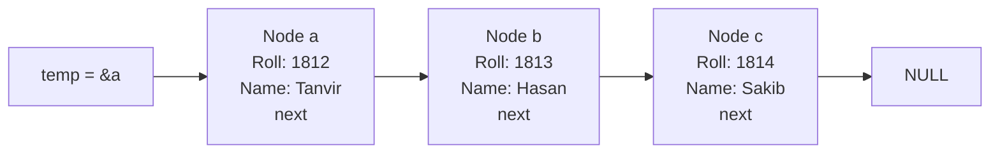

# DSA LAB 05 - link list basic

> [!abstract] Summary
> Introduces linked list concepts using static stack allocation: declaring three distinct struct instances (`a`, `b`, `c`), manually wiring their `next` pointers (`a.next = &b; b.next = &c; c.next = NULL;`), and traversing the chain with a temporary pointer.

**Source:** `1215_DSA/02_LAB/05_link_list_basic.c`

---

## The concept in plain words
Before dealing with dynamic heap memory (`malloc`/`free`), pointer chaining can be understood simply by linking local stack variables together. By storing the address of variable `b` inside variable `a`'s pointer member, `a` points to `b`.

---

## Data structure diagram


---

## Code
```c
#include<stdio.h>
#include<string.h>

typedef struct Student
{
    int roll;
    char name[100];
    double cgpa;
    struct Student *next;
} Student;

int main(){
    Student a,b,c;

    a.roll = 1812;
    b.roll = 1812;
    c.roll = 1812;
    
    strcpy(a.name, "Kazi Tanvir");
    strcpy(b.name, "Kazi Tanvir");
    strcpy(c.name, "Kazi Tanvir");

    
    a.roll = 1812;
    b.roll = 1812;
    c.roll = 1812;

    a.next = &b;
    b.next = &c;
    c.next = NULL;

    Student temp;
    temp.next = &a;

    while (temp.next != NULL)
    {
        printf("Address: %p\n", temp.next);
        temp.next = temp.next->next;
    }
    

}
```

---

## How it works
- `Student a, b, c;`: Three local struct variables allocated on the stack frame.
- `a.next = &b;`: Stores the memory address of `b` inside `a.next`.
- `b.next = &c;`: Stores the address of `c` inside `b.next`.
- `c.next = NULL;`: Sets the final pointer to `NULL` to signify the end of the chain.
- `Student *temp = &a; while (temp != NULL) { ... temp = temp->next; }`: Standard pointer traversal loop.

---

## Sample Run
```text
roll: 1812, name: Tanvir, cgpa: 3.85
roll: 1813, name: Hasan, cgpa: 3.90
roll: 1814, name: Sakib, cgpa: 3.75
```

---

## Dry run
| Iteration | `temp` Value | Node Visited | Printed Output | Next `temp` (`temp->next`) |
| :--- | :--- | :--- | :--- | :--- |
| 1 | `&a` | Node `a` | 1812, Tanvir, 3.85 | `&b` |
| 2 | `&b` | Node `b` | 1813, Hasan, 3.90 | `&c` |
| 3 | `&c` | Node `c` | 1814, Sakib, 3.75 | `NULL` |
| 4 | `NULL` | None | Loop terminates | - |

---

## Complexity
- **Traversal Time**: $O(N)$ where $N = 3$.
- **Space Complexity**: $O(1)$ auxiliary stack space.

---

## Gotchas
> [!warning] Dangling Pointers on Function Return
> Stack-allocated nodes exist only while their enclosing function executes. Returning a pointer to a local stack node from a function leads to undefined behavior! Real-world linked lists must allocate nodes on the heap using `malloc()`.

---

## Key Takeaways
- A linked list is defined by its pointer connections, not its memory locations.
- Setting the tail node's next pointer to `NULL` is mandatory to avoid infinite traversal loops.

---

## My notes
> [!question]- My notes

## Related
- [[DSA LAB 04 - link list student]] - Heap-allocated dynamic linked list
- [[ASG 10 - self ref struct]] - Struct definitions with self-referencing pointers
- [[CLASS 26 - struct student info]] - Struct mechanics in C
