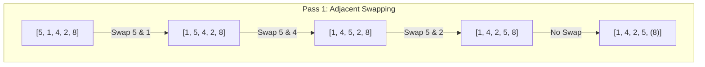

# DSA PRAC SLIDES 01 - sort bubble

> [!abstract] Summary
> Comprehensive study of the Bubble Sort algorithm in C: repeatedly stepping through an array, comparing adjacent element pairs, and swapping them if out of order so that the largest unsorted element "bubbles up" to its correct position on each pass.

**Source:** `1215_DSA/05_PRACTICE/SLIDES/01_sort_bubble.c`

---

## The concept in plain words
Bubble Sort operates by comparing elements next to each other ($arr[j]$ and $arr[j+1]$). If the left element is larger than the right element, they are swapped. After the first complete pass, the largest element is guaranteed to be at the final index.

---

## Data structure diagram


---

## Code
```c
#include <stdio.h>

void swap(int *src, int *dest){
    int temp = *src;
    *src = *dest;
    *dest = temp;
}

int bubble_sort(int *arr, int n){
    for (int i = 0; i < n; i++){
        for (int j = 0; j < n - i - 1; j++){
            if (arr[j] > arr[j + 1]){
                swap((arr+j),(arr+j+1));
            }
        }
    }
}

int main(){
    int n;
    if (scanf("%d", &n) != 1) return 1;
    int arr[n];

    for (int i = 0; i < n; i++)
        scanf(" %d", &arr[i]);
    
    bubble_sort(arr, n);

    for (int i = 0; i < n; i++)
        printf("%d ", arr[i]);
    printf("\n");

    return 0;
}
```

---

## How it works
- `swap(int *src, int *dest)` swaps values using pointer dereferencing with a temporary variable.
- Outer loop `for (int i = 0; i < n; i++)` tracks the number of completed passes.
- Inner loop `for (int j = 0; j < n - i - 1; j++)` compares adjacent elements. The bound `n - i - 1` avoids re-checking already sorted trailing elements.

---

## Sample Run
```text
Unsorted array:
5 4 3 2 1
Sorted array:
1 2 3 4 5
```

---

## Dry run
Tracing input `[5, 3, 1, 4]`:
| Pass | Inner Comparisons ($j$) | Array State After Swaps | Settled Position |
| :--- | :--- | :--- | :--- |
| Initial | - | `[5, 3, 1, 4]` | None |
| Pass 0 | $j=0 (5>3), j=1 (5>1), j=2 (5>4)$ | `[3, 1, 4, 5]` | Index 3 (`5`) |
| Pass 1 | $j=0 (3>1), j=1 (3<4)$ | `[1, 3, 4, 5]` | Index 2 (`4`) |
| Pass 2 | $j=0 (1<3)$ | `[1, 3, 4, 5]` | Index 1 (`3`) |

---

## Complexity
- **Time Complexity**:
  - Best Case: $O(n)$ with swap-detection flag optimization; $O(n^2)$ standard.
  - Average Case: $O(n^2)$.
  - Worst Case: $O(n^2)$ (reverse sorted array).
- **Space Complexity**: $O(1)$ in-place sorting.
- **Stability**: Stable (does not reorder equal elements).

---

## Gotchas
> [!warning] Redundant Inner Loop Bounds
> Looping `j < n - 1` instead of `j < n - i - 1` still sorts correctly but performs unnecessary comparisons on elements that are already in their final sorted positions.

---

## Key Takeaways
- Simple comparison-based algorithm suitable for small educational datasets.
- Each pass guarantees placement of one element at its final destination.

---

## My notes
> [!question]- My notes

## Related
- [[DSA PRAC SLIDES 02 - sort insertion]] - Insertion sort algorithm
- [[DSA PRAC SLIDES 03 - sort selection]] - Selection sort algorithm
- [[LAB 11 - sort array]] - Array sorting fundamentals from 1101
- [[LAB 24 - merge sort]] - Advanced $O(n \log n)$ divide-and-conquer sorting
