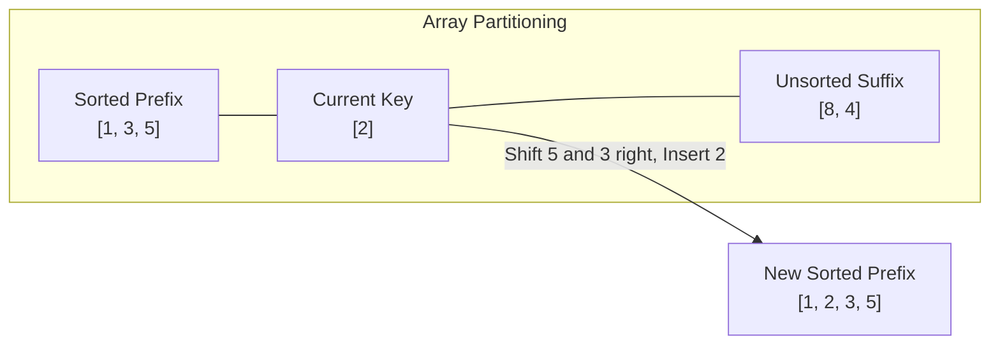

# DSA PRAC SLIDES 02 - sort insertion

> [!abstract] Summary
> Comprehensive study of the Insertion Sort algorithm in C: building a sorted array prefix one element at a time by picking the next unsorted key and shifting larger elements to the right to insert the key into its proper position.

**Source:** `1215_DSA/05_PRACTICE/SLIDES/02_sort_insertion.c`

---

## The concept in plain words
Insertion Sort functions much like sorting playing cards in your hand. You pick up the next card and slide it left past all cards that are larger, inserting it into its correct relative spot.

---

## Data structure diagram


---

## Code
```c
#include<stdio.h>

void swap(int *src, int *dest){
    int temp = *src;
    *src = *dest;
    *dest = temp;
}

void insertion_sort(int *arr,int n){
    for (int i = 1; i < n; i++){
        int temp = arr[i];
        int j = i - 1;
        for (; j  >= 0 && arr[j] > temp; j--){
                arr[j+1] = arr[j];
        }
        arr[j+1] = temp;
    }
}

int main(){
    int n;
    if (scanf("%d", &n) != 1) return 1;
    int arr[n];

    for (int i = 0; i < n; i++)
        scanf(" %d", &arr[i]);
    
    insertion_sort(arr, n);

    for (int i = 0; i < n; i++)
        printf("%d ", arr[i]);
    printf("\n");

    return 0;
}
```

---

## How it works
- Outer loop `for (int i = 1; i < n; i++)` picks `temp = arr[i]` as the key to insert.
- Inner loop `for (; j >= 0 && arr[j] > temp; j--)` scans leftwards through the sorted prefix, shifting each element `arr[j]` one position right (`arr[j+1] = arr[j]`).
- Once a smaller or equal element is encountered, `arr[j+1] = temp` drops the key into its sorted slot.

---

## Sample Run
```text
Unsorted array:
5 4 3 2 1
Sorted array:
1 2 3 4 5
```

---

## Dry run
Tracing input `[4, 3, 2, 10]`:
| Pass ($i$) | Key (`temp`) | Shifts Performed | Array State | Sorted Prefix |
| :--- | :--- | :--- | :--- | :--- |
| Initial | - | - | `[4, 3, 2, 10]` | `[4]` |
| $i=1$ | 3 | Shift 4 right $\to$ insert 3 | `[3, 4, 2, 10]` | `[3, 4]` |
| $i=2$ | 2 | Shift 4, shift 3 $\to$ insert 2 | `[2, 3, 4, 10]` | `[2, 3, 4]` |
| $i=3$ | 10 | No shifts ($10 > 4$) | `[2, 3, 4, 10]` | `[2, 3, 4, 10]` |

---

## Complexity
- **Time Complexity**:
  - Best Case: $O(n)$ (already sorted; only 1 comparison per outer pass).
  - Average Case: $O(n^2)$.
  - Worst Case: $O(n^2)$ (reverse sorted; maximum shifts).
- **Space Complexity**: $O(1)$ in-place sorting.
- **Stability**: Stable.

---

## Gotchas
> [!warning] Loop Termination Condition
> Always ensure the bounds check `j >= 0` appears **first** in the inner loop condition before evaluating `arr[j] > temp` to avoid negative array index segmentation faults!

---

## Key Takeaways
- Extremely fast for small arrays or nearly sorted data ($O(n)$ best case).
- Uses value shifting rather than full swaps, making it more efficient than bubble sort.

---

## My notes
> [!question]- My notes

## Related
- [[DSA PRAC SLIDES 01 - sort bubble]] - Bubble sort comparison
- [[DSA PRAC SLIDES 03 - sort selection]] - Selection sort comparison
- [[LAB 11 - sort array]] - General sorting fundamentals
