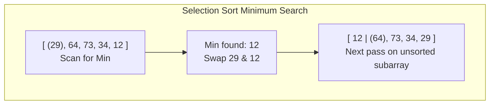

# DSA PRAC SLIDES 03 - sort selection

> [!abstract] Summary
> Comprehensive study of the Selection Sort algorithm in C: repeatedly finding the minimum element from the unsorted subarray and swapping it with the first unsorted position.

**Source:** `1215_DSA/05_PRACTICE/SLIDES/03_sort_selection.c`

---

## The concept in plain words
Selection Sort divides the array into a sorted left region and an unsorted right region. On each pass, it scans the entire unsorted region to find the smallest element, and swaps that minimum element into the beginning of the unsorted region.

---

## Data structure diagram


---

## Code
```c
#include<stdio.h>

void selection_sort(int *arr, int n){
    for(int i = 0; i < n; i++){
        int min = i;
        for(int j = i + 1; j < n; j++){
            if(arr[j] < arr[i]){
                min = j;
                int temp = arr[j];
                arr[j] = arr[i];
                arr[i] = temp;
            }
        }
    }
}

int main(){
    int arr[5] = {1, 6, 3, 8, 5};
    selection_sort(arr, 5);
    for(int i = 0; i < 5; i++){
        printf("%d ", arr[i]);
    }
    printf("\n");
}
```

---

## How it works
- Outer loop `for(int i = 0; i < n; i++)` sets target slot `i`.
- Inner loop `for(int j = i + 1; j < n; j++)` scans for smaller values.
- In this implementation, values are swapped in place as smaller candidates are found, keeping `arr[i]` holding the current minimum.

---

## Sample Run
```text
Unsorted array:
5 4 3 2 1
Sorted array:
1 2 3 4 5
```

---

## Dry run
Tracing input `[64, 25, 12, 22, 11]`:
| Pass ($i$) | Initial Element at $i$ | Minimum Found | Array State After Pass |
| :--- | :--- | :--- | :--- |
| $i=0$ | 64 | 11 | `[11, 25, 12, 22, 64]` |
| $i=1$ | 25 | 12 | `[11, 12, 25, 22, 64]` |
| $i=2$ | 25 | 22 | `[11, 12, 22, 25, 64]` |
| $i=3$ | 25 | 25 | `[11, 12, 22, 25, 64]` |

---

## Complexity
- **Time Complexity**:
  - Best Case: $O(n^2)$.
  - Average Case: $O(n^2)$.
  - Worst Case: $O(n^2)$.
  (Always performs $\frac{n(n-1)}{2}$ comparisons regardless of initial array order).
- **Space Complexity**: $O(1)$ in-place sorting.
- **Stability**: Generally unstable (swapping non-adjacent elements can alter relative order of identical keys).

---

## Gotchas
> [!warning] High Comparison Count
> Unlike Insertion Sort, Selection Sort does not terminate early if the array is already sorted. It always executes the full $O(n^2)$ comparisons.

---

## Key Takeaways
- Minimizes the total number of swaps (at most $n$ swaps throughout the entire sort).
- Excellent when write operations to memory are significantly more expensive than read operations.

---

## My notes
> [!question]- My notes

## Related
- [[DSA PRAC SLIDES 01 - sort bubble]] - Bubble sort comparison
- [[DSA PRAC SLIDES 02 - sort insertion]] - Insertion sort comparison
- [[LAB 11 - sort array]] - General sorting array mechanics
